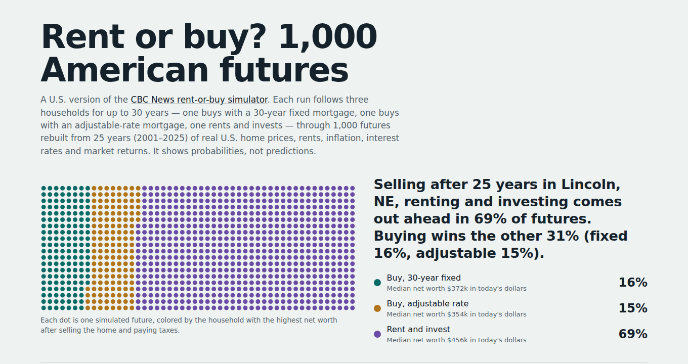

# Rent or buy? 1,000 American futures

A Monte Carlo simulator that compares three households over up to 30 years — one buys with a 30-year fixed mortgage, one buys with an adjustable-rate mortgage, one rents and invests — across 1,000 futures rebuilt from 25 years of U.S. home prices, rents, inflation, interest rates and market returns. It's a U.S. adaptation of the [CBC News rent-or-buy simulator](https://www.cbc.ca/news/business/rent-or-buy-calculator-canada-9.7370950).

**Live:** https://MirzaAtharBaig.github.io/rent-or-buy-us/



> For education only. Past patterns don't guarantee future results. Not financial, tax or legal advice.

## Quick start

```bash
git clone https://github.com/MirzaAtharBaig/rent-or-buy-us.git
cd rent-or-buy-us
python3 -m http.server 8000      # then open http://localhost:8000
```

The page loads `data/data.json` with `fetch`, so it must be served over HTTP. Opening `index.html` directly from disk won't work.

## Repository layout

```
index.html                 page markup
assets/sim.js              simulation engine (pure functions, tested)
assets/app.js              UI: inputs, charts, tables
assets/styles.css
config/assumptions.yaml    every default, labeled "sourced" or "assumption"
config/metros.yaml         locations: Zillow region, FHFA series, states
data/data.json             generated input to the page — do not edit by hand
data/series.lock.json      FHFA series resolved for each location
data/raw/                  cached source responses behind data.json
data/manual/               the one hand-maintained input (Damodaran returns)
pipeline/                  Python build: sources.py (network), transforms.py (math), build.py (CLI)
tests/                     pytest (pipeline, data checks) and node:test (engine)
.github/workflows/         CI on every push; monthly data refresh
```

## Rebuilding the data

Requires Python 3.11+ and a free [FRED API key](https://fred.stlouisfed.org/docs/api/api_key.html).

```bash
python3 -m venv .venv && source .venv/bin/activate
pip install -r requirements.txt
cp .env.example .env               # paste your FRED_API_KEY into .env
python -m pipeline.build           # fetch, transform, validate, write data/data.json
python -m pipeline.build --offline # rebuild from data/raw/ without network
```

The build fails loudly, rather than writing partial data, when a series doesn't cover the history window, a value falls outside sanity bounds, or a location can't be matched.

A GitHub Action reruns the build on the 5th of every month and commits the result if anything changed. It needs a repository secret named `FRED_API_KEY`.

## Adding a location

1. Add an entry to `config/metros.yaml`. Use the exact `RegionName` from Zillow's metro files, the state(s) for property tax, and either `fhfa_match` tokens or an explicit `fhfa_series` id from [FRED](https://fred.stlouisfed.org/searchresults/?st=All-Transactions%20House%20Price%20Index).
2. Run `python -m pipeline.build` and check the resolved series in `data/series.lock.json`.
3. Run the tests, then commit.

## Tests

```bash
pytest -q     # transforms, offline end-to-end build, data.json schema and spot checks
npm test      # engine: amortization, PMI cutoff, refinance, backtest, determinism
```

## Methodology and sources

- [METHODOLOGY.md](METHODOLOGY.md) — model, formulas, and what's left out
- [SOURCES.md](SOURCES.md) — every input with series id, transform and license notes
- [CHANGELOG.md](CHANGELOG.md)

## Citing

See [CITATION.cff](CITATION.cff). GitHub shows a "Cite this repository" button once it's on the default branch.

## License

Code: MIT ([LICENSE](LICENSE)). Data remains under its publishers' terms — see [DATA_LICENSE.md](DATA_LICENSE.md).
