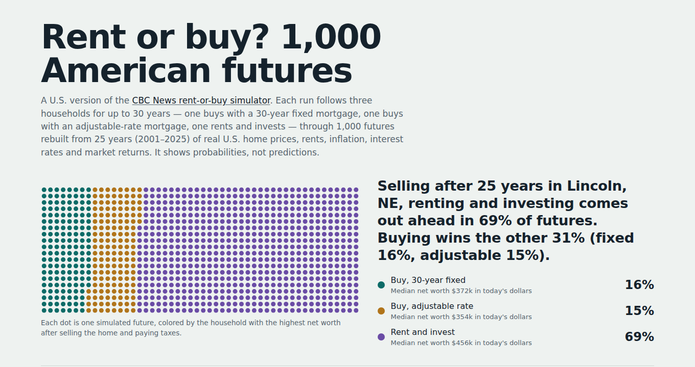

# Rent or buy? 1,000 American futures

[](https://MirzaAtharBaig.github.io/rent-or-buy-us/)
[](https://opensource.org/licenses/MIT)
[](https://www.python.org/)

> **Launch the App:** [mirzaatharbaig.github.io/rent-or-buy-us](https://MirzaAtharBaig.github.io/rent-or-buy-us/)

A Monte Carlo simulator that compares three households over up to 30 years — one buys with a 30-year fixed mortgage, one buys with an adjustable-rate mortgage, one rents and invests — across 1,000 futures rebuilt from 25 years of U.S. home prices, rents, inflation, interest rates and market returns. It's a U.S. adaptation of the [CBC News rent-or-buy simulator](https://www.cbc.ca/news/business/rent-or-buy-calculator-canada-9.7370950).

**Live:** https://MirzaAtharBaig.github.io/rent-or-buy-us/
---
<div align="center">
  <a href="https://MirzaAtharBaig.github.io/rent-or-buy-us/">
    
  </a>
  <p><em>Monte Carlo outcomes comparing 30-year fixed, ARM, and rent & invest strategies across 1,000 simulated economic futures.</em></p>
</div>


**For education only. Past patterns don't guarantee future results. Not financial, tax or legal advice.**


## Key Features

* **3-Way Strategy Comparison:** Simultaneously compare a 30-Year Fixed Mortgage, an Adjustable-Rate Mortgage (ARM), and a Renting & Investing strategy.
* **Monte Carlo Risk Engine:** Runs 1,000 statistical simulations to reveal not just median outcomes, but best-case and worst-case scenarios (5th to 95th percentiles).
* **Local Market Data:** Pre-loaded with official metro home values, regional rents, and local property tax structures across major U.S. cities.
* **Dynamic Refinancing & PMI:** Automatically simulates mortgage refinancing when interest rates drop and removes Private Mortgage Insurance (PMI) once home equity crosses 20%.
* **Purely Client-Side & Private:** Runs entirely in your browser—none of your private financial figures, income, or savings details ever touch a server.


## 🎯 Why Use Monte Carlo Simulations?

Most calculators use a fixed rate like `3% annual home appreciation`. But buying right before a market downturn produces dramatically different outcomes than buying at the start of a boom. 

By modeling **sequence-of-returns risk**, this tool helps you answer crucial questions:
* *What is my downside risk if housing prices stagnate for 5 years?*
* *Does an Adjustable-Rate Mortgage (ARM) outperform a 30-Year Fixed if interest rates fall?*
* *How much wealth do I build by investing my down payment and monthly savings into the stock market instead?*


## How to Use the Simulator

1. Open **[mirzaatharbaig.github.io/rent-or-buy-us](https://MirzaAtharBaig.github.io/rent-or-buy-us/)**.
2. **Select your metro area** to load localized housing prices, rents, and property tax averages.
3. **Customize your financial profile:**
   * Down payment percentage & home purchase price.
   * Target mortgage interest rate & term.
   * Monthly rent & market investment strategy.
4. **Analyze the 1,000 Futures Chart:** Examine median wealth outcomes, worst-case drawdown probabilities, and break-even timelines.

## Methodology & Data Sources

This model uses 25+ years of historical data to preserve realistic correlations between inflation, mortgage rates, home appreciation, and stock market returns:

* **Home Prices:** FHFA Purchase-Only House Price Index & Zillow Home Value Index (ZHVI).
* **Rent Trends:** Zillow Observed Rent Index (ZORI).
* **Mortgage & Inflation Rates:** Federal Reserve Economic Data (FRED).
* **Stock & Bond Returns:** Damodaran NYU Stern historical returns dataset.

For detailed formulas, assumptions, and math, read **[METHODOLOGY.md](METHODOLOGY.md)** and **[SOURCES.md](SOURCES.md)**.


## Developer & Local Setup

If you want to run the pipeline locally, add new metro areas, or customize the simulation engine:

```bash
# Clone the repository
git clone [https://github.com/MirzaAtharBaig/rent-or-buy-us.git](https://github.com/MirzaAtharBaig/rent-or-buy-us.git)
cd rent-or-buy-us

# Serve locally
python3 -m http.server 8000
```

## Citing

If you use this model, data pipeline, or simulator in an academic paper, blog post, or journalistic report, please cite it as follows:

```bibtex
@software{baig2026rentorbuy,
  author = {Baig, Mirza Athar},
  title = {Rent-or-Buy-US: A 1,000-Future Monte Carlo Rent-vs-Buy Simulator},
  year = {2026},
  publisher = {GitHub},
  journal = {GitHub Repository},
  url = {[https://github.com/MirzaAtharBaig/rent-or-buy-us](https://github.com/MirzaAtharBaig/rent-or-buy-us)}
}
```

See [CITATION.cff](CITATION.cff). GitHub shows a "Cite this repository" button once it's on the default branch.

## License

Code: MIT ([LICENSE](LICENSE)). Data remains under its publishers' terms — see [DATA_LICENSE.md](DATA_LICENSE.md).
